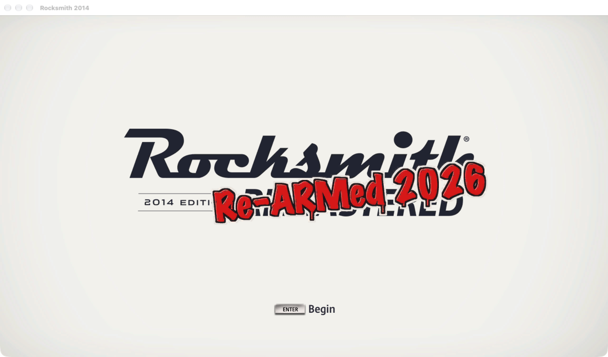

# RS Re-ARMed

A native arm64 port of Rocksmith 2014 for Apple Silicon Macs. Your own copy of the game is statically recompiled
to C at build time, and small native libraries replace what ties it to Intel Macs, Windows, Steam and online
services. It builds from either of two games:

- **The Mac game**: the Steam macOS version of Rocksmith 2014 Remastered. [Docs](docs/mac/README.md).
- **Learn & Play**: a purchased edition that Steam offers for Windows only. [Docs](docs/windows/README.md).

This project contains no game code or assets, so you need your own copy of the game. Not affiliated with or
endorsed by Ubisoft. Rocksmith is a trademark of Ubisoft.

## Requirements

- A Mac with Apple Silicon (M1 or later), macOS 12 or later.
- **Rocksmith 2014 (Remastered)** for Mac installed through Steam, or **Learn & Play** on your Steam account
  ([details](docs/windows/INSTALL.md#requirements)). No Rosetta and no Windows PC needed.
- A Real Tone cable or another audio input.

## Install

Download `RS.Re-ARMed.Installer.app.zip` from [Releases](https://github.com/bbelgg/rs-rearmed/releases), unzip it
and open it. macOS refuses the first time, as it isn't notarized: click **Open Anyway** in **System Settings**,
**Privacy & Security**. Choose your game and click **Build & Install**; it tells you when it needs you. The installer holds no game
code: it builds the app on your Mac from your own copy, so never download a built app from anywhere. The first
Learn & Play build takes about 25 minutes on an M2.

Then start **RS Re-ARMed** or **RS Re-ARMed Learn & Play** from `~/Applications`.

To build by hand: [Mac](docs/mac/INSTALL.md#build-by-hand), [Learn & Play](docs/windows/INSTALL.md#install-from-a-clone).

## Mac and Windows compared

The Windows (Learn & Play) port plays, but has had far less testing than the Mac port.

✅ works (tested) · ⚠️ present, not tested · ❌ not implemented

| Feature | Mac | Windows (Learn & Play) |
|---|---|---|
| Songs, Score Attack, Guitarcade, Session Mode, Nonstop Play, lessons with video | ✅ | ✅ |
| Rocksmith Workshop, tone designer | ⚠️ | ✅ the tone designer opens |
| Multiplayer (local), each player on any input | ✅ | ✅ |
| DLC and custom songs | ✅ | ✅ ¹ |
| Mods (`mods/` folder) and hook points | ✅ | ✅ one dylib serves both, with `rc_mod.h`; 15 of the 18 hook points and the overlay API |
| RSMods' library (`rearmed-mods.dylib`, 0.3.0) | ✅ | ✅ the same file, all 19 mods |
| Built-in fixes, Re-ARMed title logo, no intro screens or Auto Save warning | ✅ | ✅ |
| Offline, no Ubisoft sign-in, your Steam profiles copied in once | ✅ | ✅ |
| Real Tone cable | ✅ | ✅ ² |
| Microphone, other interfaces, Direct Connect | ✅ | ✅ |
| ENUMERATE: new songs without a restart | ✅ | ✅ |
| Lower guitar latency | ✅ | ⚠️ |
| Input channel and gain, every channel listed, calibration that can boost | ✅ | ✅ |
| Window, full screen, Retina | ✅ | ✅ |
| Frame rate follows the display | ✅ 75/120 Hz | ✅ 75 Hz |
| Metal renderer, shaders prepared at install | ✅ | ✅ |
| OpenGL renderer and automatic fallback | ✅ | ❌ none planned |
| Installer app and install script | ✅ | ✅ |
| Performance | ✅ about Rosetta's CPU | ✅ the display's frame rate, about 17% more CPU than the Mac port on one route, and more memory ([details](docs/windows/PERFORMANCE.md#toward-the-mac-edition)) |

¹ Learn & Play reads the PC song archives (`*_p.psarc`), the Mac game the Mac ones (`*_m.psarc`). Official DLC has both, and
the installer has Steam fetch what your account owns; custom songs often exist for one platform only.
² Tested with a virtual device named like the cable.

Status in detail: [Mac](docs/mac/PLAN.md#status), [Windows](docs/windows/PLAN.md#status).

## What it adds

- **Native.** No Rosetta and no x86 code at run time, at about the CPU of the original under Rosetta, and at your
  display's refresh rate.
- **Offline.** No Steam client while you play, no Ubisoft sign-in. Every connection that isn't local is refused and logged.
- **Your saves stay safe.** Steam saves are copied in once and never written; stored Ubisoft credentials are never copied.
- **Its own game files.** A Steam update or uninstall can't break it. On the same disk the copy takes no extra space.
- **Custom songs out of the box**, with no CDLC patch. **ENUMERATE** in the main menu adds new songs without a restart.
- **Any audio interface.** Direct Connect in the menus, every channel listed, calibration that can boost a quiet input, and lower guitar latency.
- **Built-in fixes** from [rs-mac-fixes](https://github.com/glebb/rs-mac-fixes) and [RSBypass](https://github.com/aik002/RSBypass), no intro
  screens, and mods loaded from a `mods/` folder.
- **Metal** by default, with OpenGL as a choice and automatic fallback on the Mac game.

Every fix can be switched off: [Mac](docs/mac/INSTALL.md#settings-and-switches), [Learn & Play](docs/windows/INSTALL.md#settings-and-switches).

## Known issues

- No online features.
- Progress is kept separately and isn't copied back to your Steam saves.
- Only the one Steam macOS build of the game is supported.
- With Metal, the first play of a song, venue or mode can stutter briefly in its first half-minute.
- Mods that draw with OpenGL themselves show nothing on Metal: use the overlay API or the OpenGL renderer.

More: [Mac](docs/mac/INSTALL.md#known-issues), [Learn & Play](docs/windows/INSTALL.md#known-issues). Plans, with no promise of when:
[Mac](docs/mac/PLAN.md#next-work), [Windows](docs/windows/PLAN.md#next-work).

## FAQ

**Is this an emulator?**
No. The game's x86 code is translated to C once, at build time, and compiled into an arm64 app.

**Does it change my Steam install?**
No. Your Steam folder is only read.

**Do I need Steam running?**
Only to install. The Steam client isn't used while you play.

**Where are my saves and logs?**
In `~/Library/Application Support/RS Re-ARMed/`: saves in `steam/<account>/221680/remote/`, logs in `logs/`. Learn & Play's are
in the same places under `learn-play/`.

**How do I add songs?**
Put them in your game's `dlc` folder and press **ENUMERATE** in the main menu. After changing or removing songs, click
**Refresh Game Files** in the installer.

**How do I update or uninstall?**
To update, run the new installer; your saves are kept. To uninstall, delete the app and the folder above, after backing up
`steam/` if you want your progress: [details](docs/mac/INSTALL.md#update-and-uninstall).

**Can I get a prebuilt app?**
No. A built app contains the game's code, so it can't be shared.

**How do I get the lowest guitar delay?**
Set the game's audio engine setting to 1 and restart it (2 if the sound crackles), and listen through headphones or a USB
interface, not the built-in speakers: [details](docs/mac/INSTALL.md#audio-latency).

**My interface has several inputs, or the guitar is too quiet.**
Set INPUT to DIRECT CONNECT in Path/Input and open Available Inputs. Play, pick the channel whose bar moves, then run the
game's calibration: [details](docs/mac/INSTALL.md#guitar-input).

**Where do I report bugs?**
In [GitHub Issues](https://github.com/bbelgg/rs-rearmed/issues). First check that the original game doesn't do the same (under
Rosetta, or on Windows for Learn & Play).

## Documentation

| | Mac port | Windows port (Learn & Play) |
|---|---|---|
| Index | [docs/mac](docs/mac/README.md) | [docs/windows](docs/windows/README.md) |
| Install, build, play | [INSTALL.md](docs/mac/INSTALL.md) | [INSTALL.md](docs/windows/INSTALL.md) |
| Getting the game image | [CAPTURE.md](docs/mac/CAPTURE.md) | [CAPTURE.md](docs/windows/CAPTURE.md) |
| How it works | [DESIGN.md](docs/mac/DESIGN.md), [METAL.md](docs/mac/METAL.md) | [DESIGN.md](docs/windows/DESIGN.md) |
| Performance | [PERFORMANCE.md](docs/mac/PERFORMANCE.md) | [PERFORMANCE.md](docs/windows/PERFORMANCE.md) |
| Status and plan | [PLAN.md](docs/mac/PLAN.md) | [PLAN.md](docs/windows/PLAN.md) |
| Testing | [TESTING.md](docs/mac/TESTING.md) | [TESTING.md](docs/windows/TESTING.md) |

The recompiler both use: [docs/recompiler](docs/recompiler/README.md).

## Credits

- [N64: Recompiled](https://github.com/N64Recomp/N64Recomp) and
  [XenonRecomp](https://github.com/hedge-dev/XenonRecomp), for the static-recompilation approach.
- [rs-mac-fixes](https://github.com/glebb/rs-mac-fixes) by glebb.
- [RSBypass](https://github.com/aik002/RSBypass) by aik002.
- [RSMods](https://github.com/Lovrom8/RSMods) by Lovrom8, for the menu entry that Enumerate does the job of.
- The Rocksmith modding community.
- [FFmpeg](https://ffmpeg.org/), for Bink 2 decoding.
- [Lua](https://www.lua.org/), [libpng](http://www.libpng.org/pub/png/libpng.html) and
  [libjpeg](https://www.ijg.org/).
- [Capstone](https://www.capstone-engine.org/), the disassembler used by the recompiler.

RS Re-ARMed's own code is MIT-licensed: see [LICENSE](LICENSE). Third-party components keep their own
licences: see [THIRD_PARTY_NOTICES.md](THIRD_PARTY_NOTICES.md).
