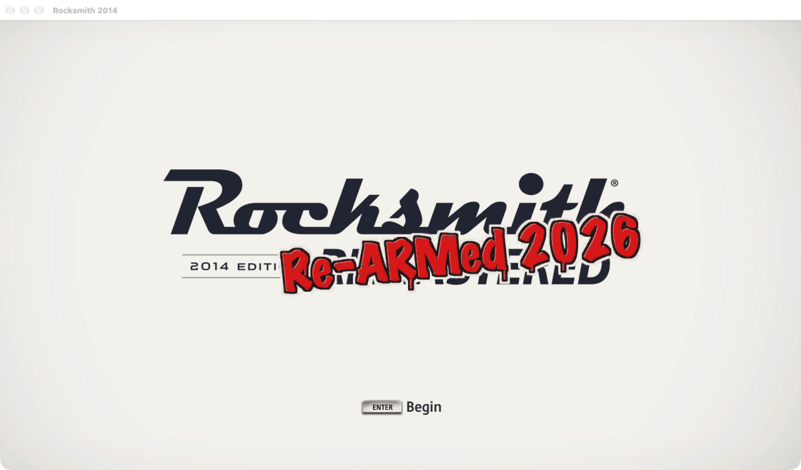

# RS Re-ARMed



RS Re-ARMed is a native arm64 port of the macOS version of Rocksmith 2014 for Apple Silicon Macs. The
game is statically recompiled to C from your own copy at build time, and small native libraries take
the place of the parts that tie it to Intel Macs, Steam and online services.

Not affiliated with or endorsed by Ubisoft. Rocksmith is a trademark of Ubisoft.

This project does not include any game code or assets; you need your own copy of the game.

## Table of Contents

- [System Requirements](#system-requirements)
- [Features](#features)
- [Built-in patches and mods](#built-in-patches-and-mods)
- [How to Install](#how-to-install)
- [Known Issues](#known-issues)
- [FAQ](#faq)
- [Building](#building)
- [Credits](#credits)

## System Requirements

- A Mac with Apple Silicon (M1 or later).
- macOS 11 Big Sur or later.
- The Steam macOS version of **Rocksmith 2014 (Remastered)**, installed through Steam.
- A Real Tone cable, or another audio input the game accepts. macOS asks for microphone access the first
  time the game listens for your guitar.

## Features

- **Native arm64.** The game runs as an arm64 app. No Rosetta, no x86 code at run time.
- **Offline by design.** The Steam client is not needed while you play: an offline Steam layer stands in
  for it. A network guard (`tools/ws8/netguard`) is loaded into the game on every launch and refuses every
  connection that is not local, every host name lookup and every attempt to open a web page, and logs
  each one. The launcher will not start the game without it.
- **Your profiles, kept separately.** On the first launch your Steam saves for Rocksmith 2014 are copied
  once into the RS Re-ARMed folder. From then on the native build uses only that copy; your Steam saves
  are never written. Stored Ubisoft credentials (`crd`) are never copied.
- **Your DLC, linked automatically.** The launcher mirrors your game folder with symlinks on every launch,
  so new DLC folders in your install show up without reinstalling.

## Built-in patches and mods

These are compiled into the app. Where a switch exists, it is an environment variable.

| What | Default | Switch |
|---|---|---|
| **rs-mac-fixes** behaviours ([rs-mac-fixes](https://github.com/glebb/rs-mac-fixes) by glebb): more keyboard keys in the game (space, Return, Esc, Tab, Backspace, arrows, F1-F12, Home/End/Page Up/Page Down, forward delete, punctuation), the End key in menus, faster loading with large song libraries (a cache for song paths and several DLC archives mounted per frame), a better hash for the game's number table, higher priority for the game's worker threads (fewer hitches), and a higher open-file limit | on | `RS_MODS_FIXES=0` turns all of them off. `RS_MODS_BUDGET_MS=N` sets the time per frame for mounting DLC archives (default 50; 0 mounts one per frame, as the original game does) |
| **RSBypass** custom-song (CDLC) signature skip (an independent rewrite of [RSBypass](https://github.com/aik002/RSBypass) by aik002): song files that fail the signature check still load. Only the song loader's check is skipped | on | `RS_MODS_BYPASS=0` enforces the signature check again |
| **Uplay sign-in prompt skipped**: Enter on the title screen goes straight to the profile list, without the "Uplay account" dialogs | on | none |
| **Offline Steam layer**: a replacement `libsteam_api` that works without the Steam client, with its cloud saves in a local folder | on | none |
| **Song ownership**: the offline Steam layer reports the base game, the DLC your account owns (the DLC Steam installed) and 248750, the free DLC that custom songs carry, as owned, so their songs show up | on | `RS_STEAM_DLC=all` reports every AppID as owned, for custom songs that carry another AppID |
| **"Re-ARMed" title logo**: a tag over the title-screen logo, built automatically from your own `static.psarc` by `tools/loadscreen` | on | `RS_REARMED=0` shows the original logo; or delete `static.psarc.rearmed` |
| **Frame rate**: the game renders at the display's refresh rate (a 75 Hz or 120 Hz display gets 75 or 120 fps; the game keeps song time at any rate). A fixed rate can be set instead, with vsync off: higher to test, or lower (e.g. 30) to save power | display | `RS_FPS=N` |
| **Multithreaded GL engine**: Apple's driver does its work on a thread of its own. Measured: the frame thread 4% shorter, total CPU 2% higher | off | `RS_GL_MTENGINE=1` |

`RS_MODS_LOG=1` writes what the mods apply to `logs/last-run.log`.

### Switching options

The launcher starts the game through macOS, so variables set in a Terminal window do not reach it. Set
them for your login session with `launchctl` before starting the game, for example:

```bash
launchctl setenv RS_MODS_BYPASS 0     # takes effect on the next launch
launchctl unsetenv RS_MODS_BYPASS     # back to the default
```

### The title logo

The build produces the Re-ARMed title logo automatically (it needs Python with Pillow, numpy and
etcpak; with `RS_PY` unset it makes its own virtual environment). To rebuild it manually, or if the
automatic step was skipped:

```bash
tools/loadscreen/build.sh "$HOME/Library/Application Support/Steam/steamapps/common/Rocksmith2014/static.psarc.rearmed"
```

It reads the game's `static.psarc`, changes only the two title-logo textures, and writes the result as a
new file next to it. The original `static.psarc` is not changed, and the launcher uses the new file
whenever it is there.

### Works with your mods

- A modified `cache.psarc` in your install (for example a fast-load mod) is used as-is.
- Custom songs (CDLC) in your install are used as-is, with the RSBypass behaviour above.

## How to Install

You build the app yourself from your own copy of the game. The game app is never shared, so never
download builds of it from anywhere.

The easiest way is the **RS Re-ARMed Installer**, the one download this project offers: get
`RS.Re-ARMed.Installer.app.zip` from the [Releases](https://github.com/bbelgg/rs-rearmed/releases)
page, unzip it and open it. It contains no game code; it builds and installs the app on your Mac from
your own copy of the game. See [docs/BUILDING.md](docs/BUILDING.md) for its prerequisites.

To build by hand instead, follow the manual build in [docs/BUILDING.md](docs/BUILDING.md). When the
build is done, install it:

```bash
tools/play-native/install.sh
```

Then start **RS Re-ARMed** from `~/Applications` (double-click, Launchpad or Spotlight).

## Known Issues

- No online features. Ubisoft (Uplay) services are not available.
- Progress made in the native build is kept separately and is not copied back to your Steam saves
  automatically.
- Only the one Steam macOS build of Rocksmith 2014 is supported.
- With a fast-load `cache.psarc` mod, a start can now and then stay on the white loading screen,
  more often when the Mac is busy. Quit and start again.

## FAQ

**Is this an emulator?**
No. The game's x86_64 code is translated to C once, at build time (static recompilation), and compiled
into an arm64 app. Nothing is translated while you play.

**Does it change my Steam install?**
No. `install.sh` copies the app into its own folder, and the launcher mirrors your install there with
symlinks. Both only read your install and your Steam folder and never write to them. The one exception
is a file you add yourself: the optional title logo, `static.psarc.rearmed`.

**Where are my saves?**
In `~/Library/Application Support/RS Re-ARMed/steam/<account>/221680/remote/`. The logs are in
`~/Library/Application Support/RS Re-ARMed/logs/`.

**Do I need Steam running?**
No. The game needs to be installed through Steam, but the Steam client is not used while you play. Your
Steam saves are read once, on the first launch.

**Do DLC and custom songs work?**
The DLC folders in your install are linked in on every launch, including ones you add later. Custom songs
load because the RSBypass behaviour is built in and on by default.

**How do I update?**
Pull the latest changes, rebuild (see [docs/BUILDING.md](docs/BUILDING.md)) and run
`tools/play-native/install.sh` again. Your saves are kept.

**How do I uninstall?**
Delete `~/Applications/RS Re-ARMed.app` and `~/Library/Application Support/RS Re-ARMed`. That folder
holds your native-build progress, so back it up first if you want to keep it. If you built the title
logo, also delete `static.psarc.rearmed` from your game folder.

**Can I get a prebuilt app?**
No. A built app contains the game's code, recompiled from your copy, so it can't be shared. Build it
yourself from your own copy, with the installer or by hand.

**Where do I report bugs?**
In [GitHub Issues](https://github.com/bbelgg/rs-rearmed/issues). First check that the bug doesn't also happen in the original game
under Rosetta; if it does, it is a bug in the game, not in this port.

## Building

See [docs/BUILDING.md](docs/BUILDING.md).

## Credits

Projects referenced and thanked:

- [N64: Recompiled](https://github.com/N64Recomp/N64Recomp) and
  [XenonRecomp](https://github.com/hedge-dev/XenonRecomp), for the static-recompilation approach.
- [rs-mac-fixes](https://github.com/glebb/rs-mac-fixes) by glebb.
- [RSBypass](https://github.com/aik002/RSBypass) by aik002.
- The Rocksmith modding community.
- [FFmpeg](https://ffmpeg.org/), for Bink 2 decoding.
- [Lua](https://www.lua.org/), [libpng](http://www.libpng.org/pub/png/libpng.html) and
  [libjpeg](https://www.ijg.org/).
- [Capstone](https://www.capstone-engine.org/), the disassembler used by the recompiler.

RS Re-ARMed's own code is MIT-licensed: see [LICENSE](LICENSE). Third-party components keep their own
licences: see [THIRD_PARTY_NOTICES.md](THIRD_PARTY_NOTICES.md).
