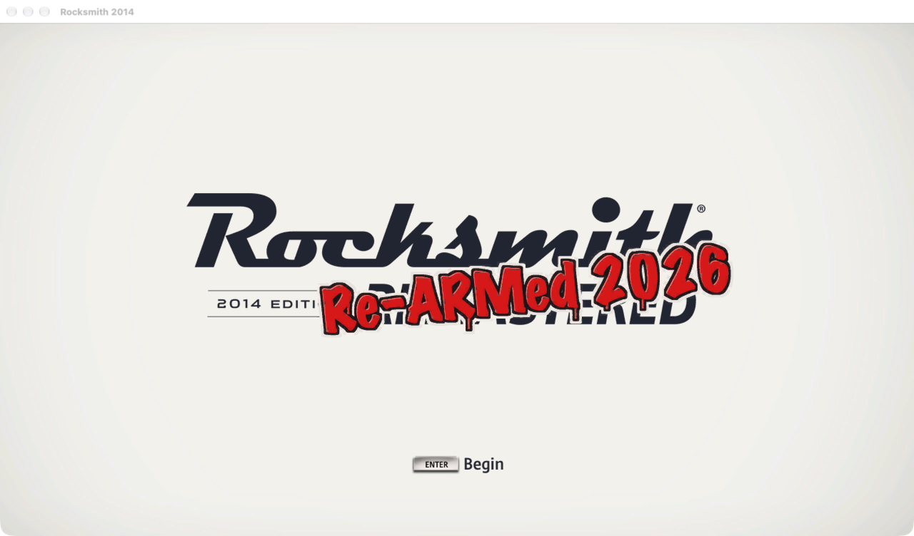

# RS Re-ARMed

A native arm64 port of Rocksmith 2014 for Apple Silicon Macs. Your own copy of the game is statically recompiled
to C at build time, and small native libraries replace what ties it to Intel Macs, Windows, Steam and online
services. It builds from either of two games:

- **The Mac game**: the Steam macOS version of Rocksmith 2014 Remastered. [Docs](docs/mac/README.md).
- **Learn & Play**: a purchased edition that Steam offers for Windows only. [Docs](docs/windows/README.md).

This project contains no game code or assets, so you need your own copy of the game. Not affiliated with or
endorsed by Ubisoft. Rocksmith is a trademark of Ubisoft.

## Why it exists

Rocksmith on the Mac stands on ground that is going away: Apple is phasing out Rosetta and has deprecated OpenGL, and
Ubisoft no longer updates the game and never brought Learn & Play to the Mac. RS Re-ARMed keeps it playing and makes
it better. The priorities:

- **Future-proof, whatever Apple or Ubisoft do.** Native code with no Rosetta, and Metal by default (the Mac game keeps
  OpenGL as a choice and automatic fallback). Offline: no Steam client while you play, no Ubisoft sign-in, and every
  connection that isn't local is refused and logged. The app has its own game files, so a Steam update or uninstall
  can't break it; on the same disk the copy takes no extra space.
- **A better game on the Mac.** It was always a bit laggy and buggy. Now it runs much smoother, without the stalls, at
  your display's refresh rate, with the fixes from [rs-mac-fixes](https://github.com/glebb/rs-mac-fixes) and
  [RSBypass](https://github.com/aik002/RSBypass) built in.
- **Proper support for external audio devices.** Any interface, not only the Real Tone cable: Direct Connect in the
  menus, every channel listed, calibration that can boost a quiet input, lower guitar latency, and multiplayer with
  each player on their own input.
- **Quality of life.** Custom songs out of the box, with no CDLC patch. **ENUMERATE** in the main menu adds new songs
  without a restart. No intro screens. Mods load from a `mods/` folder:
  [rearmed-mods](https://github.com/glebb/rearmed-mods) has RSMods' features and more, with an app to set them up.

Your Steam saves are copied in once and never written, and stored Ubisoft credentials are never copied. Every fix can
be switched off, and the switches are set in the installer (**Settings and switches…**):
[Mac](docs/mac/INSTALL.md#settings-and-switches), [Learn & Play](docs/windows/INSTALL.md#settings-and-switches).

## Requirements

- A Mac with Apple Silicon (M1 or later), macOS 12 or later.
- **Rocksmith 2014 (Remastered)** for Mac or **Learn & Play** on your Steam account
  ([Mac](docs/mac/INSTALL.md#requirements), [Learn & Play](docs/windows/INSTALL.md#requirements)). Neither has to
  be installed in Steam: the installer has Steam download it, and uses a Mac game that is installed as it is. No
  Rosetta and no Windows PC needed.
- A Real Tone cable or another audio input.

## Install

Download `RS.Re-ARMed.Installer.app.zip` from [Releases](https://github.com/bbelgg/rs-rearmed/releases), unzip it
and open it. macOS refuses the first time, as it isn't notarized: click **Open Anyway** in **System Settings**,
**Privacy & Security**. Choose your game and click **Build & Install**; it tells you when it needs you. The installer
holds no game code: it builds the app on your Mac from your own copy. A built app contains the game's code, so it
can't be shared: never download one from anywhere. A first build takes about 15 minutes for the Mac game and about
25 for Learn & Play, on an M2.

Then start **RS Re-ARMed** or **RS Re-ARMed Learn & Play** from `~/Applications`.

To build by hand: [Mac](docs/mac/INSTALL.md#build-by-hand), [Learn & Play](docs/windows/INSTALL.md#install-from-a-clone).

## Mac and Windows compared

Both editions play. Learn & Play has had far less testing than the Mac edition.

✅ works (tested) · ⚠️ present, not tested · ❌ not implemented

| Feature | Mac | Windows (Learn & Play) |
|---|---|---|
| Songs, Score Attack, Guitarcade, Session Mode, Nonstop Play, lessons with video | ✅ | ✅ |
| Rocksmith Workshop, tone designer | ⚠️ | ✅ the tone designer; ⚠️ the Workshop's other screens |
| Multiplayer (local), each player on their own input | ✅ two channels of one interface; ⚠️ a cable with an interface, two interfaces | ✅ two channels of one interface; ⚠️ a cable with an interface, two interfaces, SWAP CABLE ASSIGNMENT |
| DLC and custom songs | ✅ | ✅ ¹ |
| Mods (`mods/` folder), hook points, the overlay API and the render API | ✅ all 21 hook points | ✅ the same dylib, built with `rc_mod.h`; 20 of the 21 hook points |
| Files a mod serves to the game (`rc_file.h`) | ✅ | ✅ |
| [rearmed-mods](https://github.com/glebb/rearmed-mods) (`rearmed-mods.dylib`) | ✅ | ✅ the same file |
| Edits and mid points: a mod changes a function from the inside | ✅ | ✅ |
| 7-string charts (rearmed-mods' Seven-String Guitar, after [rs7string](https://github.com/SomeeName/rs7string)) | ✅ a chart needs a Mac archive (`_m.psarc`) | ✅ |
| Colors of notes, the highway and strings, by mods | ✅ | ✅ |
| Built-in fixes, Re-ARMed title logo, no intro screens or Auto Save warning | ✅ | ✅ |
| Calibration and the tuner the same at any frame rate | ⚠️ not yet played with a guitar above 60 Hz | ⚠️ the same |
| Skip Tuner in a Guitarcade game's tuner | ✅ the button and its warning; ⚠️ a game played with a guitar after it | ✅ ⚠️ the same |
| Switches set in the installer (Settings and switches…) | ✅ | ✅ |
| Offline, no Ubisoft sign-in, your Steam profiles copied in once | ✅ | ✅ |
| Real Tone cable | ✅ | ✅ ² |
| Microphone, other interfaces, Direct Connect | ✅ | ✅ |
| ENUMERATE: new songs without a restart | ✅ | ✅ |
| EXIT GAME in the main menu | ✅ | ✅ |
| Scroll bars dragged from anywhere on them: Learn a Song, the Tone Designer's lists and the game's other lists, and a bar for the lists that had none (Nonstop Play's songs, the Tone Designer's amps and pedals, ...) | ✅ | ✅ |
| Lower guitar latency | ✅ | ⚠️ |
| Your own plug-in in place of the game's tones (rearmed-mods' ToneHost add-on) | ✅ | ✅ |
| Input channel and gain, every channel listed, calibration that can boost | ✅ | ✅ |
| Window, full screen, Retina (MetalFX upscaling), sRGB colours on wide-colour screens | ✅ | ✅ the same renderer; the upscaled picture not checked |
| A render scale, 50-100%, for less GPU work (the installer's Render scale, under Advanced) | ✅ | ✅ 50% is fine |
| The picture switches in the game's own menu (OPTIONS → ADV DISPLAY SETTINGS) | ✅ | ✅ the eleven that apply to Metal, without RENDERER and MULTITHREADED GL ENGINE; ⚠️ four taking effect at once, not yet tried |
| Scrolling lists with the trackpad and the mouse wheel | ✅ | ✅ the same rows for the same swipe |
| A 16:10 or ultrawide screen or window drawn at its own shape | ✅ a window of any shape; ⚠️ full screen on such a screen | ✅ a window of any shape, full screen on a MacBook's screen; ⚠️ an ultrawide screen |
| Sharper textures (anisotropic filtering, the game's LOD bias) and 4x MSAA | ✅ | ✅ the same renderer; not compared with them off |
| Sharpening, after any upscaling | ✅ | ⚠️ the same renderer, not yet tried |
| A performance overlay (Apple's Metal HUD) and low-latency presentation | ✅ | ⚠️ the same code, not yet tried |
| Frame rate follows the display | ✅ 60 and 75 Hz; ⚠️ 120 Hz | ✅ 60 and 75 Hz; ⚠️ 120 Hz |
| Metal renderer, shaders prepared at install | ✅ | ✅ |
| OpenGL renderer and automatic fallback | ✅ | ❌ none planned |
| Installer app and install script | ✅ | ✅ |
| The game and your DLC downloaded by Steam, with nothing installed in Steam | ⚠️ when the game isn't installed in Steam; ✅ an installed game is used as it is | ✅ |
| Performance | ✅ the display's frame rate, about a sixth less CPU than the original under Rosetta ([details](docs/mac/PERFORMANCE.md#measured-runs)) | ✅ the display's frame rate, about the CPU of the original under Rosetta: 7-8 points of a core and 0.1 GB more than the Mac edition ([details](docs/windows/PERFORMANCE.md#toward-the-mac-edition)) |

¹ Learn & Play reads the PC song archives (`*_p.psarc`), the Mac game the Mac ones (`*_m.psarc`). Official DLC has
both, and the installer has Steam fetch what your account owns; custom songs often exist for one platform only.
² Tested with a virtual device named like the cable.

Status in detail: [Mac](docs/mac/PLAN.md#status), [Learn & Play](docs/windows/PLAN.md#status). If you own both games:
[which to build from](docs/EDITIONS.md).

## Known issues

- No online features.
- Progress is kept separately and isn't copied back to your Steam saves.
- Each edition supports one Steam build of its game.
- With Metal, the first play of a song, venue or mode can stutter briefly in its first half-minute.
- Mods that draw with OpenGL themselves show nothing on Metal: use the overlay API or the OpenGL renderer.

More: [Mac](docs/mac/INSTALL.md#known-issues), [Learn & Play](docs/windows/INSTALL.md#known-issues). Plans, with no
promise of when: [Mac](docs/mac/PLAN.md#next-work), [Learn & Play](docs/windows/PLAN.md#next-work).

## FAQ

**Is this an emulator?**
No. The game's x86 code is translated to C once, at build time, and compiled into an arm64 app.

**Does it need Steam, or change my Steam install?**
Steam is needed only to install, and isn't used while you play. Your installed game and your Steam saves are
only read. What the installer changes in Steam's folder: Steam downloads into its own download folder there (a game
that isn't installed in Steam, and the DLC you own), and when you have Steam download to another disk, the installer
links that folder there.

**Where are my saves and logs?**
In `~/Library/Application Support/RS Re-ARMed/`: saves in `steam/<account>/221680/remote/`, logs in `logs/`. Learn &
Play's are in the same places under `learn-play/`.

**How do I add songs?**
Put custom songs in the app's own `dlc` folder, `~/Library/Application Support/RS Re-ARMed/game/dlc`
(`…/RS Re-ARMed/learn-play/game/dlc` for Learn & Play): Mac archives (`*_m.psarc`) for the Mac game, PC archives
(`*_p.psarc`) for Learn & Play. The game has them at its next start, or at once with **ENUMERATE** in the main menu.
For DLC bought since the install, click **Refresh Game Files** in the installer.

**How do I update or uninstall?**
To update, open the installer: it offers a newer release and replaces itself with it, and Build & Install then updates the game; your saves are kept. To uninstall, delete the app and the folder above, after
backing up `steam/` if you want your progress: [Mac](docs/mac/INSTALL.md#update-and-uninstall),
[Learn & Play](docs/windows/INSTALL.md#update-and-uninstall).

**How do I get the lowest guitar delay?**
Set the game's audio engine setting to 1 and restart it (2 if the sound crackles), and listen through headphones or
a USB interface, not the built-in speakers: [details](docs/mac/INSTALL.md#audio-latency).

**My interface has several inputs, or the guitar is too quiet.**
Set INPUT to DIRECT CONNECT in Path/Input and open Available Inputs. Play, pick the channel whose bar moves, then run
the game's calibration: [details](docs/mac/INSTALL.md#guitar-input).

**Where do I report bugs?**
In [GitHub Issues](https://github.com/bbelgg/rs-rearmed/issues). First check that the original game doesn't do the
same (under Rosetta, or on Windows for Learn & Play).

## Documentation

| | Mac edition | Learn & Play |
|---|---|---|
| Index | [docs/mac](docs/mac/README.md) | [docs/windows](docs/windows/README.md) |
| Install, build, play | [INSTALL.md](docs/mac/INSTALL.md) | [INSTALL.md](docs/windows/INSTALL.md) |
| Getting the game image | [CAPTURE.md](docs/mac/CAPTURE.md) | [CAPTURE.md](docs/windows/CAPTURE.md) |
| How it works | [DESIGN.md](docs/mac/DESIGN.md), [METAL.md](docs/mac/METAL.md) | [DESIGN.md](docs/windows/DESIGN.md) |
| Performance | [PERFORMANCE.md](docs/mac/PERFORMANCE.md) | [PERFORMANCE.md](docs/windows/PERFORMANCE.md) |
| Status and plan | [PLAN.md](docs/mac/PLAN.md) | [PLAN.md](docs/windows/PLAN.md) |
| Testing | [TESTING.md](docs/mac/TESTING.md) | [TESTING.md](docs/windows/TESTING.md) |

The recompiler both use: [docs/recompiler](docs/recompiler/README.md). How the two games differ:
[EDITIONS.md](docs/EDITIONS.md). How such a port is made, step by step: [FROM-SCRATCH.md](docs/FROM-SCRATCH.md).
Making a release: [docs/release](docs/release/README.md). Contributing: [CONTRIBUTING.md](CONTRIBUTING.md).

## Credits

- [N64: Recompiled](https://github.com/N64Recomp/N64Recomp) and
  [XenonRecomp](https://github.com/hedge-dev/XenonRecomp), for the static-recompilation approach.
- [rs-mac-fixes](https://github.com/glebb/rs-mac-fixes) by glebb.
- [RSBypass](https://github.com/aik002/RSBypass) by aik002.
- [RSMods](https://github.com/Lovrom8/RSMods) by Lovrom8, for the menu entries that Enumerate and Exit Game do the job of.
- The Rocksmith modding community.
- [FFmpeg](https://ffmpeg.org/), for Bink 2 decoding.
- [Lua](https://www.lua.org/), [libpng](http://www.libpng.org/pub/png/libpng.html) and
  [libjpeg](https://www.ijg.org/).
- [Capstone](https://www.capstone-engine.org/), the disassembler used by the recompiler.

RS Re-ARMed's own code is MIT-licensed: see [LICENSE](LICENSE). Third-party components keep their own
licences: see [THIRD_PARTY_NOTICES.md](THIRD_PARTY_NOTICES.md).
